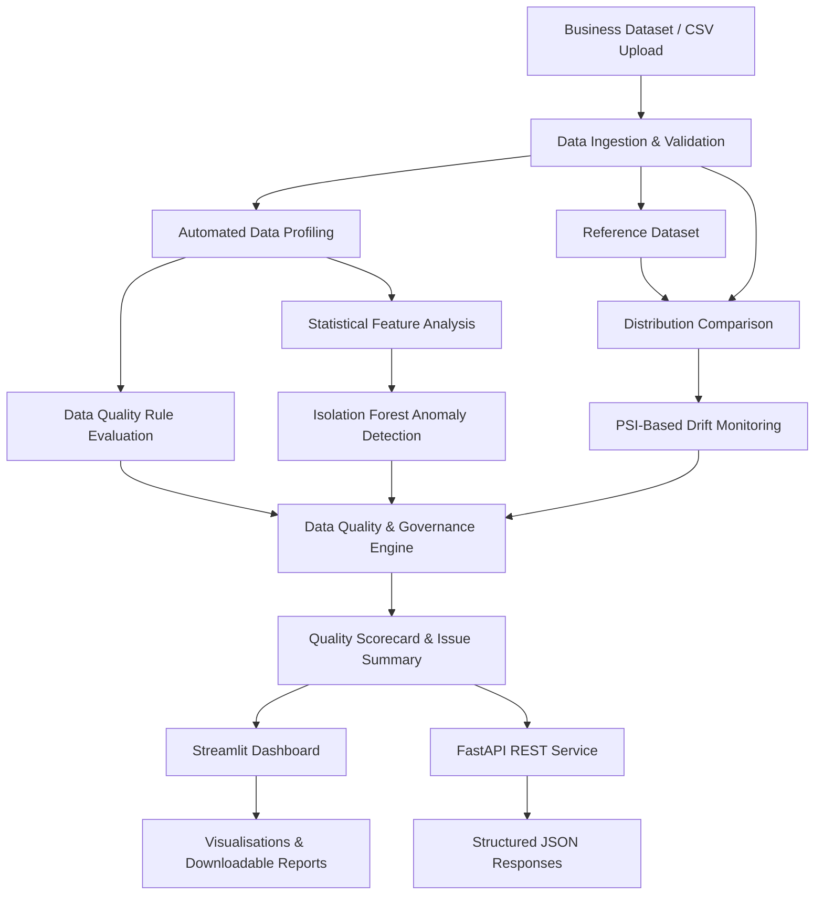

# Automated Data Quality, Anomaly Detection and Business Data Governance Platform

An end-to-end data observability and governance system designed to assess business dataset quality, identify unusual records, monitor changes in data distributions, and generate actionable data quality insights. The platform integrates automated data profiling, configurable validation rules, Isolation Forest anomaly detection, and Population Stability Index (PSI) monitoring. It transforms raw business data into structured quality assessments and governance-oriented reports through an interactive Streamlit dashboard and FastAPI REST service.

> **Data Notice:** The included datasets are synthetically generated for demonstration and testing. This project is an educational portfolio prototype, not a certified data governance, regulatory compliance, or enterprise data observability solution. Quality scores and anomaly flags are analytical indicators that require contextual review.

## Key Features

- **Automated Data Profiling:** Evaluates completeness, uniqueness, validity, numerical summaries, and categorical distributions.
- **Configurable Data Quality Rules:** Validates required fields, duplicate records, numerical ranges, and permitted categorical values.
- **Row-Level Anomaly Detection:** Uses Isolation Forest to identify statistically unusual records.
- **Data Drift Monitoring:** Compares current and reference dataset distributions using Population Stability Index.
- **Data Quality Scorecard:** Summarises dataset quality using configurable quality dimensions and validation results.
- **Issue Identification:** Highlights missing values, duplicate records, invalid entries, and unusual observations.
- **Business-Oriented Reporting:** Generates quality summaries and downloadable analytical reports.
- **Interactive Dashboard:** Provides dataset exploration, quality metrics, anomaly visualisation, and drift analysis through Streamlit.
- **REST API Integration:** Exposes data profiling, validation, and analytical functionality through FastAPI.
- **Reproducible Experiments:** Includes synthetic datasets, exploratory notebooks, technical documentation, and unit tests.

## System Architecture



## Core Analytical Modules

### 1. Automated Data Profiling

Examines the overall structure, completeness, and statistical characteristics of business datasets.

**Profiling dimensions:**

- Total number of records and columns
- Missing-value counts and percentages
- Duplicate record identification
- Unique-value counts
- Numerical feature distributions
- Mean, median, minimum, and maximum values
- Categorical frequency distributions
- Data type and schema inspection

The profiling module provides an initial understanding of dataset reliability before downstream analytics.

### 2. Data Quality Assessment and Rule-Based Validation

Evaluates datasets against configurable business validation rules.

**Supported quality dimensions:**

| Dimension | Description |
|---|---|
| Completeness | Checks required fields and missing values |
| Uniqueness | Identifies duplicate records and identifiers |
| Validity | Checks data types, permitted values, and numerical ranges |
| Consistency | Evaluates configured relationships and business constraints |
| Accuracy | Requires comparison against trusted source information; cannot be established from profiling alone |

**Example validation rules:**

- `record_id` must be unique.
- `customer_id` must not be missing.
- `order_value` must be non-negative.
- `quantity` must contain positive integer-like values.
- `days_to_ship` must be non-negative.
- `order_status` must belong to the configured set of permitted categories.

Rules are configurable and should be adapted to the actual business domain and data-owner requirements.

### 3. Machine Learning-Based Anomaly Detection

Implements the Isolation Forest algorithm to identify unusual observations within numerical data.

**Algorithm:** Isolation Forest

The model identifies records that differ from the broader data distribution by isolating observations through random partitioning.

**Analytical workflow:**

1. Select relevant numerical features.
2. Prepare and validate model inputs.
3. Handle missing values and feature transformations as required.
4. Train or apply the Isolation Forest model.
5. Generate anomaly predictions and anomaly scores.
6. Identify records requiring further inspection.
7. Present flagged observations through the dashboard.

**Typical outputs:**

- Normal observations
- Potentially anomalous observations
- Anomaly scores
- Flagged record summaries
- Feature-level exploration

An anomaly flag indicates statistical unusualness, not necessarily an incorrect record, fraudulent activity, or misconduct.

### 4. Data Drift and Distribution Monitoring

Uses Population Stability Index (PSI) to compare the distribution of current data with a reference dataset.

**Population Stability Index:**

\[
PSI = \sum_{i=1}^{n}
(A_i-E_i)\ln\left(\frac{A_i}{E_i}\right)
\]

Where:

- \(A_i\) = Current dataset proportion in bin \(i\)
- \(E_i\) = Reference dataset proportion in bin \(i\)
- \(n\) = Number of comparison bins

**Illustrative PSI interpretation:**

| PSI Value | Interpretation |
|---|---|
| Below 0.10 | Low distribution change |
| 0.10–0.25 | Moderate distribution change |
| Above 0.25 | High distribution change |

These are heuristic monitoring bands, not universal statistical standards. PSI indicates distribution change and does not establish its cause or prove model performance degradation.

**Monitoring capabilities:**

- Reference versus current dataset comparison
- Numerical feature distribution analysis
- Categorical distribution comparison, where supported
- Feature-level PSI calculation
- Drift summary and visualisation
- Identification of variables requiring investigation

### 5. Data Quality Scorecard and Governance Insights

Combines profiling and validation outputs into an understandable dataset quality summary.

**Scorecard components:**

- Completeness assessment
- Uniqueness assessment
- Validity assessment
- Consistency checks
- Anomaly distribution
- Data drift indicators
- Validation issue summaries

A configurable quality score can help communicate dataset condition to business users and data stakeholders.

**Important:** A quality score is a configurable analytical indicator, not a certified measure of data accuracy, regulatory compliance, or governance maturity.

### 6. Interactive Data Observability Dashboard

The Streamlit dashboard brings data profiling, quality assessment, anomaly detection, and drift monitoring together.

- Dataset overview and KPI summaries
- Missing-value and duplicate analysis
- Data quality scorecard
- Validation rule results
- Anomaly detection visualisations
- Flagged record exploration
- Reference versus current distribution comparison
- PSI monitoring charts
- Downloadable quality reports
- Interactive dataset filtering

## Dataset Description

The demonstration rule configuration expects a business transaction dataset with the following fields:

| Column | Description |
|---|---|
| `record_id` | Unique record identifier |
| `customer_id` | Customer identifier |
| `region` | Geographic or business category |
| `order_value` | Non-negative numerical order amount |
| `quantity` | Positive integer-like quantity |
| `days_to_ship` | Non-negative shipping duration |
| `order_status` | Order status category |

**Allowed `order_status` values:**

- `Delivered`
- `Pending`
- `Cancelled`
- `Returned`

The profiling and anomaly detection modules can be adapted to other datasets by configuring the relevant schema, validation rules, and numerical features.

## Technology Stack

| Category | Technologies |
|---|---|
| Programming Language | Python |
| Data Processing | Pandas, NumPy |
| Machine Learning | Scikit-learn |
| Anomaly Detection | Isolation Forest |
| Data Drift Monitoring | Population Stability Index |
| Statistical Analysis | Descriptive Statistics |
| Data Visualisation | Matplotlib, Plotly |
| Dashboard | Streamlit |
| Backend API | FastAPI, Uvicorn |
| Data Format | CSV, JSON |
| Testing | Pytest |
| Development Environment | Jupyter Notebook, VS Code |
| Version Control | Git, GitHub |

## Quick Start

### Prerequisites

- Python 3.10 or later
- pip package manager
- Git (optional)

### 1. Clone the Repository

```bash id="6p2w9m"
git clone <repository-url>
cd <repository-folder>
```

### 2. Create a Virtual Environment

```bash id="8x4q1v"
python -m venv venv
```

**Windows:**
```bash id="3m7k5p"
venv\Scripts\activate
```

**macOS / Linux:**
```bash id="9v2n6x"
source venv/bin/activate
```

### 3. Install Dependencies

```bash id="4q8m2w"
pip install -r requirements.txt
```

### 4. Generate the Synthetic Dataset

```bash id="5n1x7p"
python scripts/generate_data.py
```

### 5. Launch the Streamlit Dashboard

```bash id="2v6p9k"
streamlit run app/streamlit_app.py
```

Open the local URL displayed in the terminal to access the interactive data quality dashboard.

> **Note:** The commands above assume the example script and application paths exist in the repository. Adjust them to match the actual implementation.

## FastAPI Integration

The project includes a lightweight REST API for accessing data quality and analytical functionality.

### Start the API Server

```bash id="7m3q8v"
uvicorn api.main:app --reload
```

### Access Interactive API Documentation

Open Swagger UI:

```text id="1p5x9n"
http://127.0.0.1:8000/docs
```

### API Capabilities

- API health checks
- Dataset profiling
- Data quality validation
- Anomaly detection
- Reference versus current data comparison
- PSI-based drift analysis
- Structured JSON analytical responses

Actual endpoint names, supported operations, and request/response schemas should match the implemented FastAPI service.

## Model and Evaluation Considerations

**Data Quality Assessment**

- Track missing-value rates.
- Measure duplicate record frequency.
- Evaluate configured validation-rule failures.
- Compare quality results across datasets and processing runs.

**Anomaly Detection**

- Examine flagged record proportions.
- Review false-positive and false-negative behaviour when labelled validation data is available.
- Evaluate sensitivity to contamination settings and feature selection.
- Confirm that unusual observations are not automatically treated as errors.

**Drift Monitoring**

- Compare current and reference distributions.
- Monitor feature-level PSI values.
- Ensure consistent binning and preprocessing between comparison datasets.
- Investigate significant changes before taking corrective action.

**Important:** Isolation Forest does not establish whether an observation is genuinely incorrect without appropriate ground truth or expert review. PSI measures distribution shifts, not concept drift or predictive performance degradation.

## Project Structure

```text id="5w9m2q"
Automated_Data_Quality_Governance/
│
├── api/
│   └── main.py                  # FastAPI application
│
├── app/
│   └── streamlit_app.py         # Interactive dashboard
│
├── data/
│   ├── synthetic_data.csv       # Synthetic business dataset
│   └── reference_data.csv       # Reference dataset
│
├── docs/
│   ├── methodology.md           # Analytical methodology
│   ├── data_dictionary.md       # Dataset documentation
│   └── governance_notes.md      # Data governance guidelines
│
├── notebooks/
│   └── exploratory_analysis.ipynb
│
├── scripts/
│   └── generate_data.py         # Synthetic data generation
│
├── src/
│   ├── profiling.py              # Automated data profiling
│   ├── validation.py             # Quality rule validation
│   ├── anomaly_detection.py      # Isolation Forest
│   ├── drift_detection.py        # PSI monitoring
│   └── quality_score.py          # Quality scorecard
│
├── tests/                        # Unit tests
│
├── requirements.txt
└── README.md
```

*This is a suggested repository layout. Retain the actual filenames and modules implemented in your project.*

## Limitations

- The included datasets are synthetically generated.
- Configured validation rules are illustrative and require domain-specific adaptation.
- Isolation Forest identifies statistically unusual observations, not confirmed data errors.
- Anomaly results depend on feature selection, preprocessing, and model configuration.
- PSI thresholds are heuristic and should not be interpreted as universal standards.
- Distribution changes do not necessarily indicate poor data quality.
- PSI alone cannot detect every type of data drift or establish concept drift.
- A composite quality score can hide important differences between individual quality dimensions.
- This prototype is not a certified governance, security, privacy, or regulatory compliance product.

## Responsible Use and Data Governance

- Use this project strictly for educational, research, and portfolio demonstration purposes.
- Use legally obtained and appropriately authorised datasets.
- Protect sensitive information and avoid exposing confidential or personally identifiable records.
- Define validation rules in collaboration with relevant data owners and domain experts.
- Review anomaly flags before correcting, excluding, or rejecting records.
- Investigate drift signals before changing business processes or analytical models.
- Maintain clear documentation of data sources, transformations, validation rules, and monitoring assumptions.
- Apply suitable access controls and data retention practices when working with authorised business data.
- Do not treat automated quality scores as substitutes for legal, privacy, security, or regulatory assessments.

## Future Enhancements

- Automated schema and contract validation
- Advanced statistical anomaly detection
- Multivariate anomaly detection
- Data lineage and metadata tracking
- Automated data quality alerting
- Historical quality score tracking
- Advanced drift detection techniques
- Data quality monitoring across multiple pipelines
- Role-based access control and audit logging
- Integration with data warehouses and cloud platforms
- Automated reporting and scheduled monitoring
- Docker-based deployment and enterprise integration

## Author

**Mohamed Riyaz S.**  
Integrated M.Tech – Computer Science and Engineering (Business Analytics)  
Vellore Institute of Technology (VIT), Chennai
